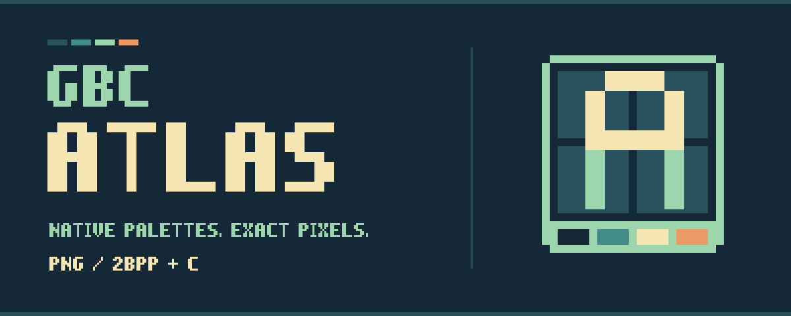

# gbc-atlas



gbc-atlas converts a native PNG atlas and JSON manifest into Game Boy Color
2bpp tiles, palette/cell maps, region and animation metadata, and C headers.
It validates the approved pack, generates reproducible output, and can preserve
unreferenced artifacts in configured recovery storage.

You can use it directly from a terminal or with an agent's assistance. Conversion
requires neither an agent nor a running editor. It reads exact palette matches;
it does not paint, resize, quantize, or repair artwork.

Requires Python 3.10+. The generated code uses standard fixed-width C types and
is suitable for GBDK-2020. Pillow handles image reading; Python 3.10 also uses
Tomli for TOML configuration.

## Choose your starting path

**Working without an agent:** follow the
[getting-started guide](https://github.com/cliffom/gbc-atlas/blob/v0.3.1/docs/GETTING_STARTED.md).
Try the complete synthetic pack first, then author/export your own artwork in
Aseprite, prepare the [manifest](https://github.com/cliffom/gbc-atlas/blob/v0.3.1/src/gbc_atlas/skills/create-atlas/references/format.md),
review the revision, and record approval. No skill installation or MCP connection
is required for this direct workflow.

**Working with an agent:** use the same installation and project configuration.
Run `gbc-atlas skill-path` (or `poetry run gbc-atlas skill-path`) and have the agent
read that directory's `SKILL.md` and referenced documents. Give it the project's
art direction, asset brief, draft location, and runtime constraints. The bundled
skill requires Aseprite MCP for agent drawing and editor review, plus approval
of the concrete revision before production handoff. Load the installed skill
directly or copy its entire directory into your client's skill location.

Both routes end with an approved pack and the same `gbc-atlas handoff` / `check`
commands. Configure paths in `[tool.gbc-atlas]`; no consumer Python wrapper is
needed. The game compiles the generated C and owns runtime loading, resource
allocation, and gameplay tests.

## Install and use

For a fresh C game project, follow the [getting-started guide](https://github.com/cliffom/gbc-atlas/blob/v0.3.1/docs/GETTING_STARTED.md).
It covers virtual environments or Poetry, a runnable synthetic pack, native C
compilation, real artwork approval, Make/pre-commit integration, and recovery.

Install the package in your project's environment:

```sh
poetry add gbc-atlas==0.3.1
```

Add project configuration to `pyproject.toml`:

```toml
[tool.gbc-atlas]
manifests = ["assets/art/*/*.atlas.json"]
output = "src/generated"
types-header = "include/asset_types.h"

[tool.gbc-atlas.retention]
roots = ["assets/art", "assets/review"]
retire-to = "build/review/retired"
```

Then use the shared handoff directly, without a custom `assets.py`:

```sh
poetry run gbc-atlas validate assets/art/prop/prop.atlas.json
poetry run gbc-atlas handoff
poetry run gbc-atlas check
```

All paths resolve relative to the configuration file. Pass
`--config path/to/pyproject.toml` when running elsewhere. Handoff validates every pack's recorded
approval and output destinations before writes. With retention configured, it
moves unreferenced artifacts into a unique recovery directory, preserving bytes
and project-relative paths. The manifest and its declared files are retained;
`.gitkeep` is preserved. Keep recovery storage ignored and inspect the printed
path. Removing that storage discards its recovery copies. Omit the retention
table to disable retirement entirely.

Check is read-only and verifies arrays, the type header, and configured retention.
Use dedicated generated/managed directories. Symlinks, path escapes, overlapping
managed/output/retirement directories, duplicate IDs, missing manifests, stale
approval, and orphan generated C/headers fail before moving/writing files.
Interrupted I/O can still leave a partial handoff; recovery files are not deleted.
Handoff does not promote drafts or grant human approval.

- [Complete project configuration](https://github.com/cliffom/gbc-atlas/blob/v0.3.1/src/gbc_atlas/skills/create-atlas/references/project.md)
- [Executable consumer example](https://github.com/cliffom/gbc-atlas/blob/v0.3.1/examples/consumer/README.md), tested using the
  installed CLI with synthetic assets and no consumer Python

For simple explicit-input conversion, the original commands remain available:

```sh
gbc-atlas generate --input assets/art --output src/generated
gbc-atlas check --input assets/art --output src/generated
```

These do not use project configuration or retire artwork. `--input` accepts one
manifest or a recursively searched directory. Configured `generate` is also
supported but refuses extras that require retirement; use `handoff` for those.
Do not mix `--config` with explicit input/output arguments.

## Optional GBDK ROM banking

Set `bank = "auto"` in `[tool.gbc-atlas]` to emit autobanked atlases, or an
integer `0..255` for a GBDK bank pragma (`255` is the autobank sentinel).
For explicit inputs use `generate/check --input ... --output ... --bank auto`.
Use the same settings for generation and read-only checks. Omission preserves
the original toolchain-neutral output byte for byte. Output configuration does
not change manifest v1 or approval digests.

Banked output includes GBDK's platform header, a `<ID>_BANKED` marker,
`BANKREF(<id>)`, and `BANKREF_EXTERN(<id>)`. Every array for one atlas, including
regions and animations, shares one translation unit and one ROM bank. Compile
and link autobanked output with GBDK `-autobank` and a suitable cartridge type.
An atlas must fit in one bank; the linker owns placement and capacity checks.

From code executing in fixed ROM (or a safe fixed-ROM loader), save
`CURRENT_BANK`, call `SWITCH_ROM(BANK(example_prop))`, read/copy/upload the arrays,
then restore the saved bank. All metadata reads require the same bank as tiles;
near pointers carry no bank information. Do not switch out the currently executing
code, retain near pointers for later reads without switching again, or let
interrupt handlers change banks without restoring them. See the bundled
[format contract](src/gbc_atlas/skills/create-atlas/references/format.md) for an example.

## Optional deduplication and flip reuse

Set `deduplicate = true` in `[tool.gbc-atlas]`, or use `--deduplicate` with
explicit `generate/check --input ... --output ...`. To estimate savings without
approval or writes, run `gbc-atlas validate <manifest> --deduplicate`.
Validation and handoff report original/emitted tile counts and tiles saved.
Both options are output policy: existing pack approvals remain valid, and
omitting the options preserves all generated files byte for byte.

Deduplication keeps the first occurrence in encoding order and reuses exact
2bpp indices only within the same kind and local palette. X/Y/XY mirrors reuse
the same tile with per-cell attribute bits `0x20`/`0x40` in `<id>_cell_flags`.
Sprites reuse whole 8×16 even/odd pairs: Y flips the entire pair and swaps its
displayed halves. Named region rectangles and animation references stay stable;
resolve their cells through maps rather than hard-coded tile IDs or contiguous
byte ranges. The [format contract](src/gbc_atlas/skills/create-atlas/references/format.md)
specifies reconstruction for compiler previews and runtime loaders.

This is an optional C interface v1 extension: `<ID>_HAS_CELL_FLAGS` and the flags
array exist only with deduplication enabled. The shared type header and
`AssetRegion` layout are unchanged. Loaders must consume flags when enabled;
old loaders that ignore flips cannot reconstruct deduplicated art correctly.
VRAM/palette allocation and runtime ROM bank switching remain consumer-owned.

## Python API

```python
from pathlib import Path
from gbc_atlas import load_atlas, render_c, render_types, verify_approval

atlas = load_atlas(Path("assets/art/prop/prop.atlas.json"))
verify_approval(atlas)
outputs = render_c(atlas)  # dict[str, str], no writes
outputs["asset_types.h"] = render_types()
```

`Atlas` exposes `manifest`, `digest`, `tiles`, `cell_tiles`, `palettes`, `regions`,
and `dimensions` (columns, rows). `cell_flags` is `None` by default or a row-major
tuple when `load_atlas(..., deduplicate=True)` is used; `tiles_saved` reports the
reduction. `render_c(atlas, bank="auto")` enables banking independently.
`plan_handoff(..., bank="auto", deduplicate=True)` exposes both output policies.
`load_atlas` performs technical validation and
encoding; it does not require approval. `render_c` is also available for technical
fixtures. Production workflows call `verify_approval` before rendering. The CLI
enforces that gate. For Python-based integrations, `load_project`,
`plan_project`, and `apply_handoff` expose the same configured handoff:
`apply_handoff(plan_project(load_project()), "handoff")`. The command can also be
`generate` or `check`. Treat a plan as a snapshot
and do not modify inputs between planning and application. Do not mutate a loaded result before verifying/rendering it;
reload after source or metadata changes. Invalid contracts raise `ValueError`.

The shared `asset_types.h` defines the C interface version 1. Generate or check it
with the same package release as the arrays; do not maintain a divergent copy.
Consumers with an existing type header may write `render_types()` to their include
directory instead. `render_c(..., generator_label="tools/assets.py")` lets
consumers preserve existing provenance comments when adopting the package.

## Authoring skill and format

Run `gbc-atlas skill-path` to locate the release's bundled `create-atlas` skill.
Copy that whole directory into your client's skill directory, or load its
`SKILL.md` directly if supported. Reinstall it when upgrading the converter.
A project-local adapter should identify art direction, paths, checks, budgets,
and handoff policy. No global skill installation is performed automatically.

- [Shared skill](https://github.com/cliffom/gbc-atlas/blob/v0.3.1/src/gbc_atlas/skills/create-atlas/SKILL.md)
- [Manifest v1 and C interface](https://github.com/cliffom/gbc-atlas/blob/v0.3.1/src/gbc_atlas/skills/create-atlas/references/format.md)

Package version, manifest version, and C interface version are separate contracts.
The initial extraction preserves manifest v1's digest algorithm and encoding,
including custom metadata and bound editable/review files. Digests detect drift;
they cannot prove human approval or that the PNG matches the editable document.
The converter currently limits each atlas to 256 cells and eight local palettes;
these are converter ceilings, not whole-scene VRAM, palette, or OAM allocations.

Scene consumers should follow the [palette interpretation contract](src/gbc_atlas/skills/create-atlas/references/format.md#palette-interpretation-for-scene-consumers)
for resolving region cells and animation frames. BG identity preserves all four
ordered RGB5 entries; OBJ identity preserves ordered entries 1–3. The local
bundle ceiling is distinct from the separate scene pools. See the synthetic
[conformance examples](examples/palette-semantics/README.md) for portable bundles
and passing/over-budget scene selections. Validation proves neither scene fit
nor human artwork approval.

## Development

```sh
poetry install
poetry run ruff check .
poetry run ruff format --check .
poetry run python -m unittest discover -s tests -v
poetry check --lock
poetry build
```

Tests use synthetic artwork, exact 2bpp round trips, known digest/output fixtures,
and native C compilation. Game-specific ROM and emulator tests remain in the
consuming project. A C compiler is required for the compile test. Test an
installed wheel too, so the C header and skill resources are verified as shipped.

## Releases

Publishing a GitHub release runs `.github/workflows/publish.yml`. It validates the
tag and package version, runs the reusable check workflow on Python 3.10 and
3.14, and publishes the tested wheel and source distribution to PyPI. Draft
releases and tag pushes alone do not publish. A failed check blocks publishing.

Use [Semantic Versioning](https://semver.org/spec/v2.0.0.html): `vMAJOR.MINOR.PATCH`
tags must match `[project].version` in `pyproject.toml`. Increment major for
incompatible public API changes, minor for compatible features, and patch for
compatible fixes. While the major version is zero, signal breaking changes with
a minor bump. The public contract includes the documented Python API, CLI,
manifest/digest rules, and generated C interface; format versions remain separate.

Prerelease tags use `v1.2.3-alpha.1`, `v1.2.3-beta.1`, or `v1.2.3-rc.1` and must
be marked as prereleases in GitHub. Their Python versions are `1.2.3a1`,
`1.2.3b1`, and `1.2.3rc1`, respectively. This supported SemVer subset maps directly
to [Python package versions](https://packaging.python.org/en/latest/specifications/version-specifiers/).
Other prerelease labels, build metadata, and leading zeros are rejected.
Stable tags must not be marked as prereleases.

One-time setup before the first release:

1. Create a GitHub environment named `pypi` in `cliffom/gbc-atlas`.
2. Configure a [PyPI pending trusted publisher](https://docs.pypi.org/trusted-publishers/creating-a-project-through-oidc/)
   for project `gbc-atlas`, owner `cliffom`, repository `gbc-atlas`, workflow
   `publish.yml`, and environment `pypi`. For an existing project, add the same
   configuration as a normal trusted publisher. Publishing uses OIDC, with no
   API-token secret. The separate publish job has `id-token: write` and receives
   only the already-tested distribution artifacts.

For each release, update the version and documentation/example/hook release pins
(for example, `poetry version 0.1.0`), run
the development checks above, commit the change, and publish the GitHub release
for the matching tag (`v0.1.0`). For a release candidate use
`poetry version 0.2.0rc1` and a prerelease tagged `v0.2.0-rc.1`. Released versions
are immutable; fixes get a new version. The workflow validates consistency but
cannot determine whether a code change deserves a major, minor, or patch bump.
